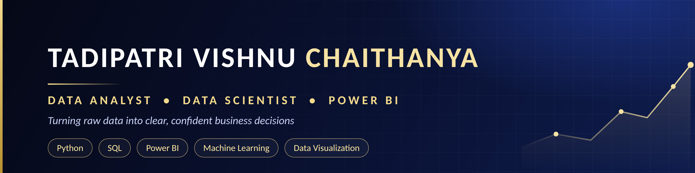
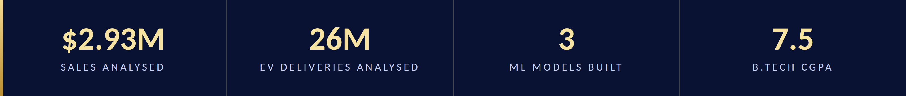
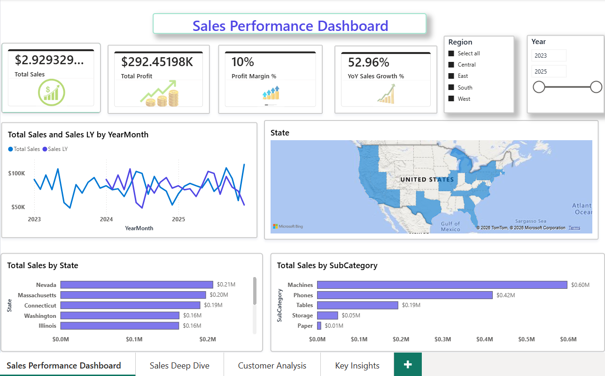
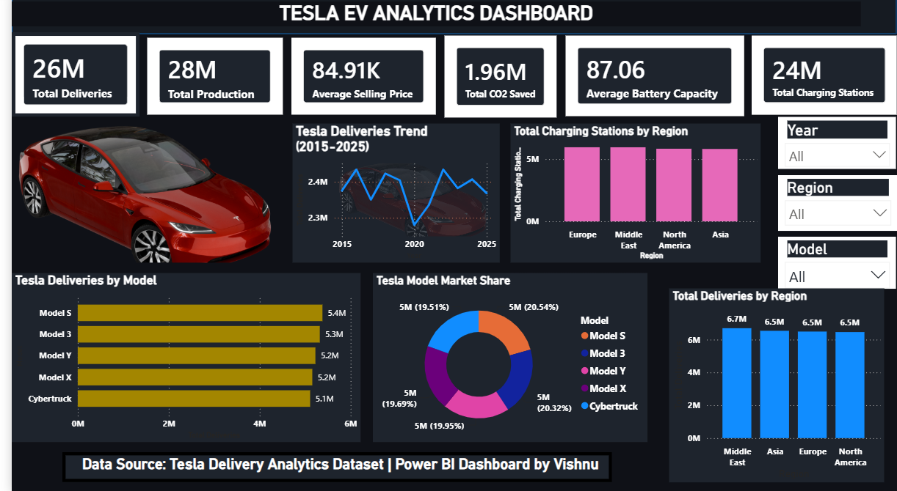
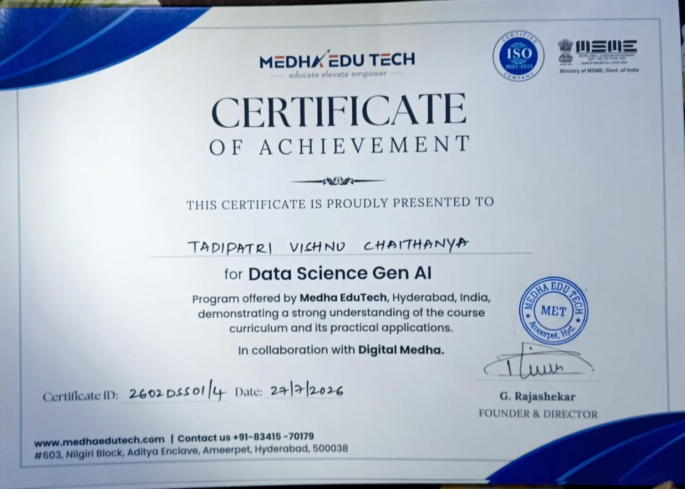
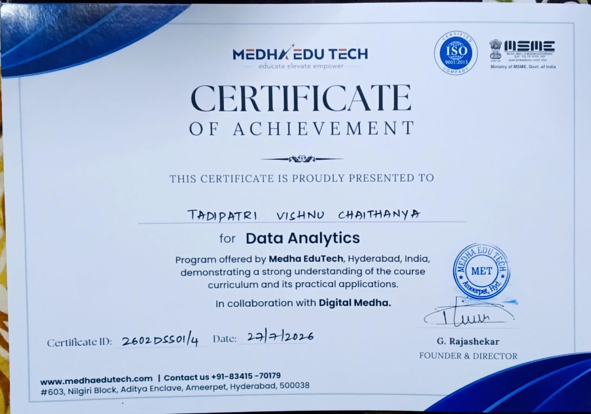
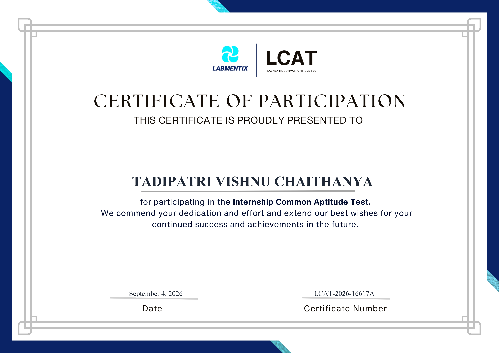

<table>
<tr>
<td width="190" align="center" valign="middle">

</td>
<td valign="middle">

### Hi, I'm Vishnu 👋
**Computer Science (AI & ML) graduate** who builds interactive **Power BI dashboards** and **end-to-end machine learning models**.
I'm looking for an **entry-level Data Analyst / Data Scientist role or internship**.

</td>
</tr>
</table>

 

| | |
|---|---|
| 🎓 **Education** | B.Tech, Computer Science & Engineering (AI & ML), A1 Global Institute of Engineering & Technology (JNTUK), 2022–2026 · CGPA **7.5** |
| 🎯 **Looking for** | Entry-level Data Analyst / Data Scientist roles, internships and freelance projects |
| 🛠️ **Core skills** | Python · SQL · Power BI (DAX, Power Query) · Excel · Scikit-learn |
| 🌱 **Learning now** | Artificial Intelligence and Generative AI, including LLMs and deep learning |
| 📍 **Based in** | Anantapur, Andhra Pradesh, India 🇮🇳 |

My projects follow the full workflow: data cleaning, EDA, feature engineering, modelling, validation and a clear dashboard or write-up, so the results are easy to act on.

 

<table>
<tr>
<td width="50%" valign="top">

#### 📈 Superstore Sales Performance
A 4-page interactive dashboard (Sales · Deep Dive · Customer · Insights) covering sales across US regions, states and product categories.

- 💰 **$2.93M** sales · **$292K** profit · **10%** margin
- 🚀 **52.96%** YoY sales growth (2023–2025)
- 🏆 Top subcategory: **Machines ($0.60M)**
- 🎛️ Region and Year slicers with a US state map

`Power BI` · `DAX` · `Power Query`

**[View repository →](https://github.com/vishnu-chaithanya-ds/superstore-sales-dashboard)**

</td>
<td width="50%" valign="top">

#### ⚡ Tesla EV Analytics
An interactive dashboard on Tesla deliveries, production, market share and CO₂ impact across models and regions, 2015–2025.

- 🚗 **26M** deliveries · **28M** production
- 🌍 **1.96M** CO₂ saved · **$84.91K** average price
- 🏆 Top model **Model S (5.4M)** · top region **Middle East (6.7M)**
- 🎛️ Year, Region and Model slicers

`Power BI` · `DAX` · `Power Query`

**[View repository →](https://github.com/vishnu-chaithanya-ds/tesla-ev-analytics-dashboard)**

</td>
</tr>
</table>

 

| Project | What it does | Approach | Code |
|---|---|---|---|
| 🚗 **Vehicle Selling Price Prediction** | Predicts used-vehicle selling prices from specifications, mileage and market value | Winsorizer outlier treatment, label encoding, Linear Regression baseline vs **Ridge Regression** tuned with GridSearchCV, MSE, R² and 5-fold cross-validation | [Repo](https://github.com/vishnu-chaithanya-ds/selling-price-of-vehicles) |
| 🌧️ **Next-Day Rainfall Prediction** | Binary classifier built on 10 years of Australian weather data | Date feature engineering, RISK_MM dropped to prevent leakage, outlier treatment (winsorize, clipping, top-coding), **Logistic Regression**, accuracy vs null accuracy | [Repo](https://github.com/vishnu-chaithanya-ds/predicting-next-day-rainfall) |
| 🚙 **Car Evaluation Classifier** | Classifies car acceptability from vehicle attributes | Ordinal encoding, **Decision Tree** (Gini, max_depth 3), train 78.5% vs test 80.5% so no overfitting | [Repo](https://github.com/vishnu-chaithanya-ds/car-evaluation) |
| 🌸 **Iris Flower Classification** | Predicts iris species from four flower measurements | **KNN (k = 10)**, 80/20 split, confusion matrix heatmap and classification report | Documented |
| 🌌 **Pulsar Star Detection** | Finds real pulsars among 17,898 signal candidates (only 9% are real) | Winsorizer, StandardScaler, **SVM**, recall-focused evaluation for class imbalance | Documented |
| ⛽ **Petrol Consumption Prediction** | Predicts petrol consumption across 48 US states | **Decision Tree Regressor** with GridSearchCV (cv = 10): R² 0.20 → 0.344, RMSE 135.89 → 123.05 | Documented |

**Python practice:** [`python-fundamentals`](https://github.com/vishnu-chaithanya-ds/python-fundamentals) (core Python, OOP, file handling) · [`python-learning`](https://github.com/vishnu-chaithanya-ds/python-learning) (practice notebooks toward data science)

 

**Languages & databases** &nbsp;

**Analytics & visualisation** &nbsp;

**Machine learning** &nbsp;

**Tools** &nbsp;

**Statistics:** Probability · Hypothesis testing · Statistical analysis

 

<table>
<tr>
<td width="33%" align="center" valign="top">
 
<b>Data Science Gen AI</b> Medha EduTech · July 2026
</td>
<td width="33%" align="center" valign="top">
 
<b>Data Analytics</b> Medha EduTech · July 2026
</td>
<td width="33%" align="center" valign="top">
 
<b>LCAT – Internship Common Aptitude Test</b> Labmentix · Sept 2026 · Certificate of Participation
</td>
</tr>
</table>

 

- 🤖 **Generative AI** and large language models (LLMs)
- 🧠 **Deep learning** and neural networks
- 🗄️ **Advanced SQL** and database design
- 📈 **Advanced Power BI** (DAX and reporting)

 

**Open to internships, entry-level roles, freelance work, startups and research or open-source data projects.**

*"Without data, you're just another person with an opinion."* — W. Edwards Deming

